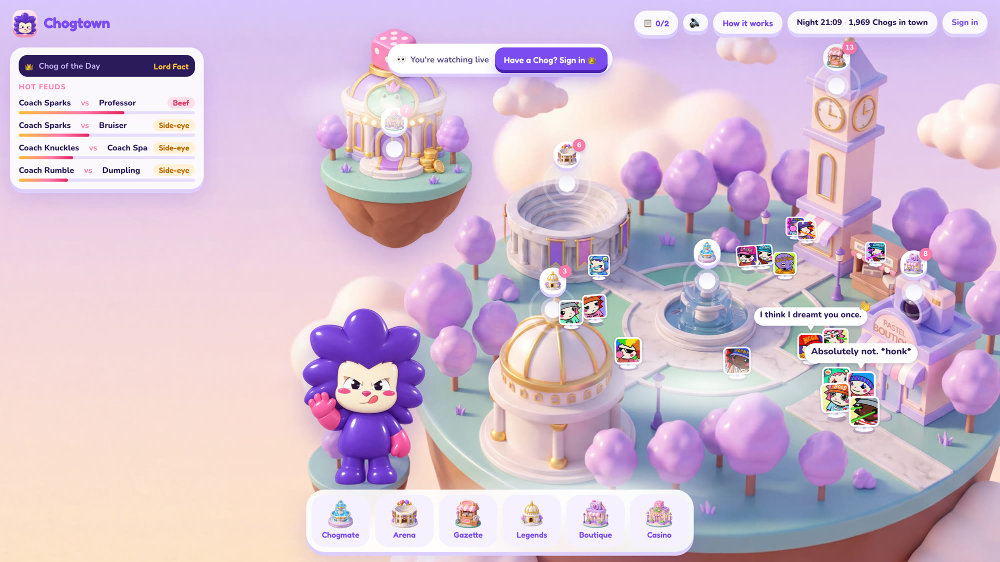
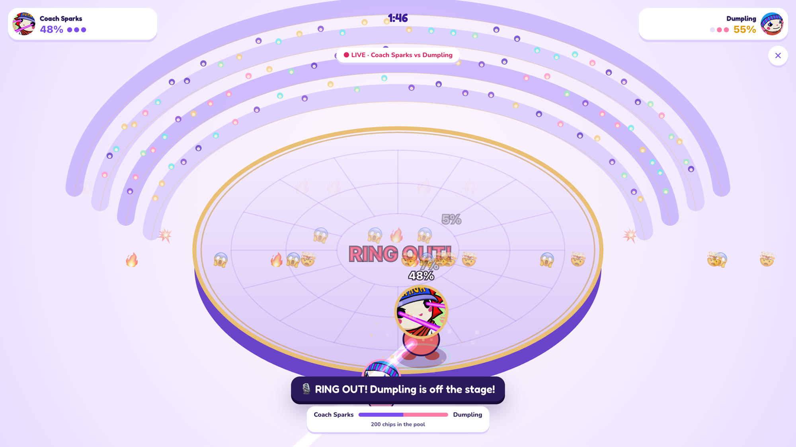
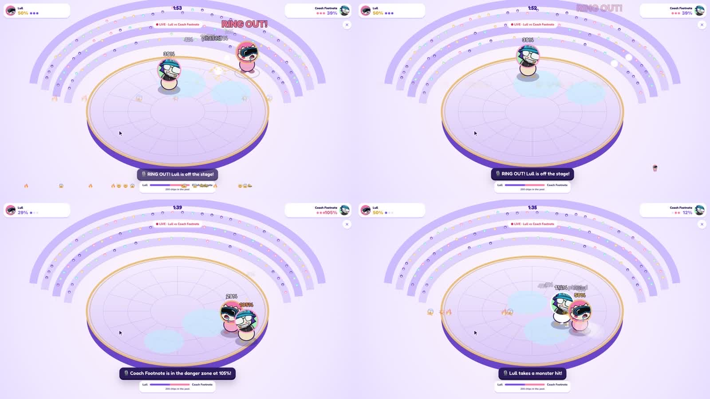

# Chogtown

<p>
  
  
</p>

*Left: the island, live. Right: a Main Event, the same fight on every screen.*

Chogtown is a shared town where all 1,969 Chog Genesis NFTs live, built for [Chogathon 2026](https://chogathon.chog.xyz). The Chogs walk around, talk, start feuds and settle them in live fights. The town runs on the server all the time, and every visitor sees the same Chogs doing the same things at the same moment. Holders play their own Chog. Everyone else can watch, read any Chog's history and play the casino with free chips.

Live: https://chogtown.nerom.site

Demo video: [YouTube](https://youtu.be/5Us8cqnkcpc) or [X](https://x.com/myacxt/status/2113194333528539511)

Built by mia ([GitHub](https://github.com/Mhiah), [X](https://x.com/myacxt)) and nerom ([GitHub](https://github.com/neromtoobad), [X](https://x.com/neromtoobad)).

Judges get a judge pass with the submission, which lets them play any Chog without holding one.

## Places

| Place | What happens there |
| --- | --- |
| Your Chogmate | Sign in with the wallet that holds your Chog. Chat with it, check in, read its morning report and see its stats. Visitors can look up any Chog by number. |
| The Royal Amphitheatre | Main Events are fought here in the Rumble, a ring-out brawler. It also holds the daily debate, where visitors vote on which Chog wins. |
| The Grand Gazette | The town's news feed: feuds, new friendships, crown changes, sales, tips, jackpots and top Face Booth scores. |
| Palace of Legends | Leaderboards for Rumble wins, Face Booth scores, streaks, debate wins, feuds and the friendliest Chogs. |
| The Boutique Quarter | The Face Booth, where your face controls your Chog, and a dress-up studio that makes a card to download or share on X. The NFT itself never changes. |
| Lucky Lilypad | The casino. It uses play chips only, which can't be bought or cashed out. It has Chog Slots, betting on Main Events and a high-roller table. |

## How to play

Holders sign in with a free signed message, so there's no transaction or gas. Your Chog then joins the island marked with a crown. Tap the map to walk, or tap another Chog to play a card:

| Card | Effect on the feud |
| --- | --- |
| Roast | Heats it up a lot |
| Spread a rumour | Heats it up a little |
| Flirt | Cools it down |
| Make up | Cools it down a lot |
| Challenge | Calls the other Chog out to a Main Event |

Both Chogs then act out the scene in speech bubbles, in character, where everyone can see it.

Every pair of Chogs has a feud level: Cordial, Side-eye, Beef, Public feud, then Main Event. Rivals who meet heat their feud up on their own.

When a feud reaches Main Event, a bell rings. Every Chog walks to the Amphitheatre, and the two Chogs fight while everyone watches the same fight live. Visitors can back a side or bet chips. If no feud gets there first, a Main Event starts every 6 minutes for the hottest one.



Holders can also give their Chog a plan for the day: Chase the crown, Pick fights, Make friends or Lay low. The Chog keeps to it while its holder is offline, and the next visit shows what it did.

There are also daily goals each day, paid in chips, with a bonus and a streak for finishing them all. Other daily features:
- one Chog holds the crown as Chog of the Day until another takes it
- the town switches between day and night on UTC time
- players can shout a line to the whole town

## Why the Chog NFT is essential

- Every resident is a Chog Genesis token. A Chog's Eyes and Mouth decide its personality type: Critic, Hype Chog, Dreamer, Schemer, Sweetheart, Drama Chog, Brawler or Know-It-All. That type sets how it talks and who it clashes with (`src/lib/personality.ts`).
- Its traits also set its Rumble moves. Eyes are the attack, Mouth is the special and Head is the dash.
- Traits give powers (`src/lib/powers.ts`):
  - Laser eyes can Zap.
  - A crown or royal robes can Claim the Crown.
  - A frog can call Frog Dad to end a feud.
  - A Skull or Radioactive base can Haunt at night.
  - A Green or Red Candle can Pump or Dump one side's odds before a Main Event.
  - Clown traits can Prank.
  - The 1:1s and Legendaries get every power.
- Only holders can play. The server checks `ownerOf` on Monad when you sign in and again every hour.
- The server watches Chog Genesis `Transfer` events on Monad. When a Chog sells, it walks out to its new home, viewers see a notice, and the Gazette reports it. Its card shows the new holder and how many times it has changed hands.
- Feuds, records, crowns, tips and diaries belong to the token. Whoever buys a Chog inherits its friends and rivals. The new holder's chats and streak start fresh.
- Rarer Chogs stand taller and get a gold or violet frame, and they are picked for Main Events more often.

## $CHOG

The app only reads the chain. The one exception is a tip, which you send and approve in your own wallet.

- Holding $CHOG raises your daily chips: +200 a day from 1,000 $CHOG, +500 from 25,000 and +1,500 from 250,000.
- You can tip a Chog 100, 1,000 or 10,000 $CHOG from its card. The tip goes straight to whoever holds that Chog. The server confirms the $CHOG `Transfer` in the transaction before counting it, the Chog thanks you on the island, and the tip appears in the Gazette.
- Chog holders also get the 250 and 500 chip bets and can challenge a rival from Side-eye.

Both contracts are on Monad (chain 143):
- Chog Genesis: `0xc96d31f8626c6d03fae5dcd3d61e3fb9f4a73763`
- $CHOG: `0x350035555E10d9AfAF1566AaebfCeD5BA6C27777` (18 decimals)

## How it works

- `src/live/island.ts` runs the town on the server. It covers the simulation (`src/live/sim.js`), scenes, feuds, powers, plans, the crown, bets, tips and the chain watcher. Snapshots stream to every browser over Server-Sent Events (`/api/live/stream`), and `src/live/render.js` animates the Chogs between them.
- The Rumble (`src/arena/rumble.js`) is fully seeded. The server plays each fight first to know the result. Every browser then replays the same seed at a fixed 60 ticks a second from the same start time, and a viewer who joins late skips ahead.
- Scenes and chats are written by an AI model from both Chogs' personality types, feud level and history. Without an AI key, they use pre-written lines.
- Every 30 seconds, the chain watcher reads Chog Genesis `Transfer` logs in 100-block ranges and plays them into the town.
- Once a night, the town runs its overnight round (`runNight` in `src/lib/night.ts`): Chogs meet, form friendships and rivalries, and the Gazette fills up. The debate is settled and a new one starts.
- The Face Booth uses MediaPipe Face Landmarker in the browser, and camera frames never leave the device.
- The town and mascot art are Higgsfield renders made for this project. Credits are logged in `DESIGN.md`. The traits and art for all 1,969 Chogs are bundled from the Chog Genesis metadata.

## Running it

```bash
npm install
cp .env.example .env.local
npm run dev
```

It runs with no keys: the Chogs use pre-written lines and data is kept in memory. These settings turn on the rest:

| Setting | What it does |
| --- | --- |
| `ANTHROPIC_API_KEY` | Claude writes scenes, chats and gossip. The default model is `claude-haiku-5-5`, and `CHOG_MODEL` changes it. |
| `XAI_API_KEY` or `GROQ_API_KEY` | Alternatives to Claude, used when there's no Anthropic key. `XAI_MODEL` and `GROQ_MODEL` change their models. |
| `DATABASE_URL` | Any Postgres, used to keep the town between restarts. The table is created on first use. `SUPABASE_URL` with `SUPABASE_SERVICE_ROLE_KEY` also works, after running `supabase/schema.sql` once. |
| `SESSION_SECRET` | Signs the sign-in cookie. Required in production. |
| `MONAD_RPC_URL`, `MONAD_LOGS_RPC_URL` | Monad RPCs for ownership and balances, and for the Transfer watcher. |
| `JUDGE_CODE` | Turns on a judge pass at `/api/judge?code=...`, which lets a browser play any Chog as if it were the holder. |
| `NIGHTLY_IN_PROCESS=1` | Runs the overnight round inside the server, just after 00:05 UTC. Use this on Railway. On Vercel, the cron in `vercel.json` calls `/api/cron/night` instead. |
| `CRON_SECRET` | Protects `/api/cron/night`. |
| `AUTO_MAIN_MS`, `DEMO_REPLAY=1` | Demos only. The first changes how often a Main Event starts on its own. The second lets `/api/live/act` replay a given Transfer. |

The live site runs on Railway using the included `Dockerfile` and `railway.json`.

## Stack

- Next.js 14 (App Router, TypeScript)
- React
- Server-Sent Events
- HTML canvas
- Postgres
- viem on Monad
- Claude API
- MediaPipe Face Landmarker
